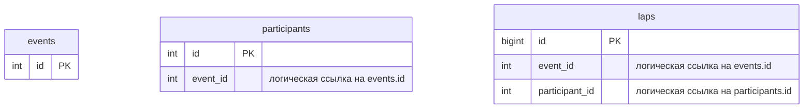
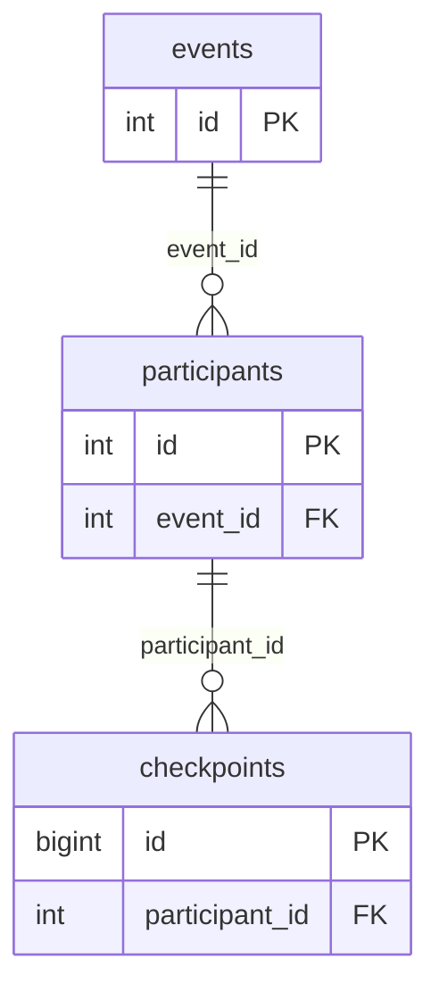
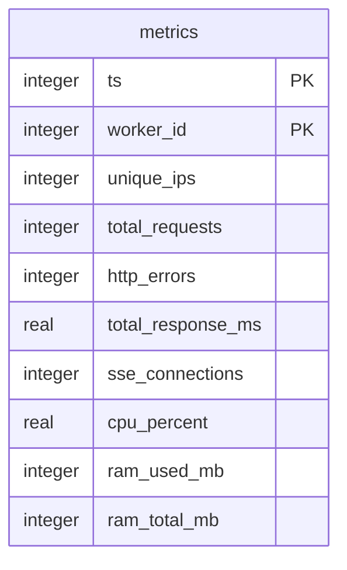

# ER-диаграммы баз данных KM_track

Схемы сняты с доступного MySQL 17.11.2026 через `information_schema` и дополнены локальным описанием SQLite. В диаграммах показаны только реальные ограничения `FOREIGN KEY`; одинаковые имена полей и связи, поддерживаемые кодом без ограничения БД, сами по себе связью не считаются. Состав таблиц меняется миграциями.

## `krasmarafon` — результаты и регистрации

```mermaid
erDiagram
    clients ||--o{ leads : "client_id"
    events ||--o{ leads : "event_id"
    clients ||--o{ results : "client_id"
    events ||--o{ results : "event_id"
    events ||--o{ result_segments : "event_id"
    results ||--o{ result_segments : "result_id"

    clients {
        int id PK
    }
    events {
        int id PK
    }
    leads {
        int id PK
        int client_id FK
        int event_id FK
    }
    results {
        int id PK
        int client_id FK
        int event_id FK
    }
    result_segments {
        int id PK
        int result_id FK
        int event_id FK
    }
    age_group_configs {
        int id PK
    }
    age_group_modes {
        string event_name PK
        string event_distance PK
    }
    athlete_claim_attempts {
        bigint id PK
    }
    athlete_claims {
        bigint id PK
    }
    athlete_find_attempts {
        bigint id PK
    }
    athlete_login_codes {
        bigint id PK
    }
    athlete_reps {
        bigint id PK
    }
    athlete_requests {
        bigint id PK
    }
    athlete_sessions {
        bigint id PK
    }
    bib_ranges {
        int id PK
    }
    club_names {
        string club PK
    }
    dq_actions {
        int id PK
    }
    dq_decisions {
        int id PK
    }
    ext_registrations {
        int id PK
    }
    km_order_parts {
        int lead_id PK
    }
    km_transitions {
        int client_id PK
        string event_name PK
        int event_year PK
    }
    participant_photos {
        int id PK
    }
```

В таблицах `km_order_parts`, `km_transitions`, `athlete_claims` и `participant_photos` есть поля-идентификаторы связанных сущностей, однако MySQL не обеспечивает для них ссылочную целостность.

## `siberman` — результаты, карточки и жеребьёвка

```mermaid
erDiagram
    participants ||--o{ checkpoint_times : "participant_id"
    checkpoints ||--o{ checkpoint_times : "checkpoint_id"
    participants ||--o{ overall_results : "participant_id"
    participants ||--o{ stage_totals : "participant_id"
    participants ||--o{ transitions : "participant_id"
    draw_applicants ||--o{ draw_picks : "applicant_id"
    siberman_persons ||--o{ siberman_person_links : "person_id"
    siberman_persons o|--o{ siberman_person_reviews : "person_id, ON DELETE SET NULL"
    siberman_entries ||--o{ siberman_entries_audit : "entry_id"

    participants {
        int id PK
    }
    checkpoints {
        int id PK
    }
    checkpoint_times {
        int id PK
        int participant_id FK
        int checkpoint_id FK
    }
    overall_results {
        int id PK
        int participant_id FK
    }
    stage_totals {
        int id PK
        int participant_id FK
    }
    transitions {
        int id PK
        int participant_id FK
    }
    draw_applicants {
        int id PK
    }
    draw_picks {
        int id PK
        int applicant_id FK
    }
    siberman_persons {
        int id PK
    }
    siberman_person_links {
        int race_year PK
        string bib PK
        string relay_stage PK
        int person_id FK
    }
    siberman_person_reviews {
        int id PK
        int person_id FK
    }
    siberman_entries {
        int id PK
    }
    siberman_entries_audit {
        int id PK
        int entry_id FK
    }
    draw_audit {
        bigint id PK
    }
    draw_config {
        int draw_year PK
    }
    draw_contacts {
        int draw_year PK
        string format PK
        string fio_key PK
    }
    race_config {
        int race_year PK
    }
    siberman_applicants {
        string tranid PK
    }
    siberman_person_audit {
        int id PK
    }
    siberman_records {
        int id PK
    }
```

`siberman_person_links` связывает человека с исходным участником по значениям полей, но FK на `participants` в схеме нет.

## `triatleta_24h` — 24-часовая гонка

В этой схеме все три таблицы существуют, но MySQL не задаёт между ними FK. `participants.event_id` и `laps.event_id` указывают на `events.id`, а `laps.participant_id` — на `participants.id` по смыслу приложения.

## `duathlon_222` — дуатлон

## Локальная SQLite `data/server_metrics.db`

У `metrics` составной первичный ключ `(ts, worker_id)`, индексы — по `ts`. Таблица не связана с MySQL-схемами.

## Ограничения чтения диаграмм

- Между четырьмя MySQL-схемами FK нет.
- В `krasmarafon` и ряде вспомогательных таблиц `siberman` есть смысловые связи, хранимые в коде или выраженные полями, но не гарантируемые FK. Здесь они не нарисованы.
- Каталог показывает структуру подключённого MySQL на дату проверки; локальные миграции могут быть ещё не применены или отличаться на других окружениях.
