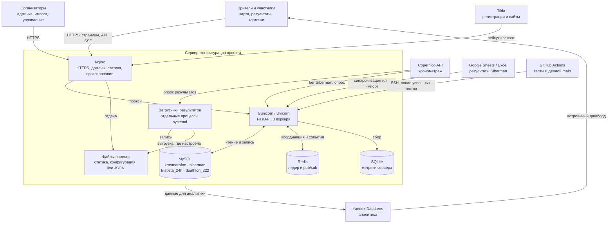

# Архитектура платформы KM_track

Обзор по коду и конфигурации репозитория на 17.11.2026. Фактическое состояние сервисов на сервере отдельно не проверялось.

## Что происходит

- Nginx направляет домены Красмарафона, Siberman и Triatleta к общему приложению; часть статических файлов отдаёт сам. В FastAPI направления разделены роутерами и сервисами.
- Загрузчики читают Copernico и сохраняют результаты. Для Siberman приложение также умеет опрашивать Copernico и Google Sheets; источники включаются настройками. Организаторы могут загружать файлы вручную.
- Воркеры используют Redis для выбора лидера и распространения обновлений; приложение передаёт живые обновления клиентам через SSE. Метрики сохраняются отдельно в SQLite.
- Регистрации могут приходить из Tilda через вебхуки. DataLens использует данные для аналитики и встраивается в интерфейс. Межтабличные связи описаны в [ER-диаграммах](database-er.md).
- При push в `main` GitHub Actions запускает тесты и затем деплой на VPS. Диаграмма описывает настроенный процесс; текущий статус сборки или серверных служб здесь не подтверждён.

Источники: `app.py`, `src/krasmarafon/router.py`, `src/siberman/google_sheet_sync.py`, `deploy/nginx.conf`, `deploy/km_track.service`, `deploy/run_loader.sh`, `.github/workflows/deploy.yml` и [ER-диаграммы](database-er.md).
